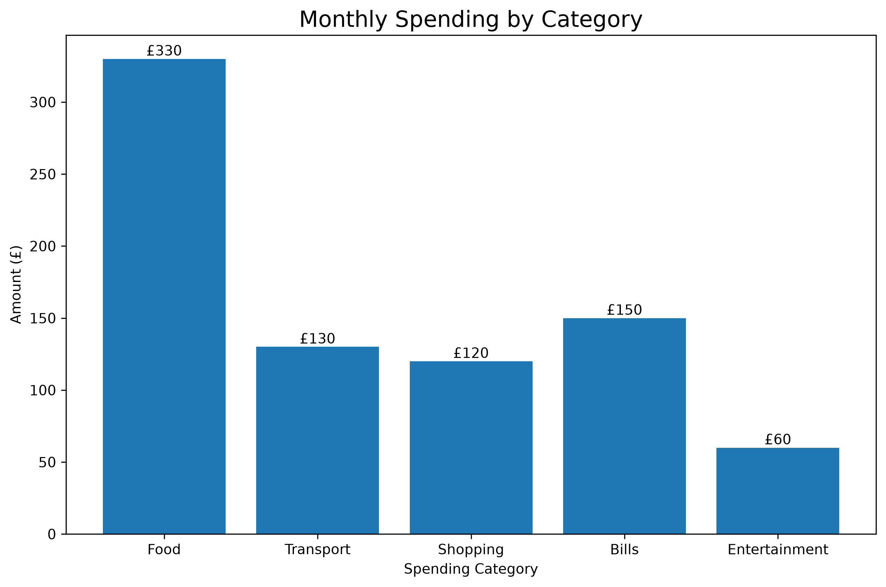

# Personal Finance & Spending Analysis with Python 

## Project Overview

This project uses python to analyse anonymised personal finance transactions provided by a friend. It examines spending patterns, calculates expenditure by category, and visualises monthly spending. 

The project demonstartes practical applications of Python programming, financial calculations, data analysis and data visualiation techniques using real-world transaction data. 

## Objectives:

- calculate monthly savings as well as savings rate.
- calculate total expenditure from individual transactions. 
- Group transactions by spending category.
- calculate each category's percentage of total expenditure.
- Identify the highest spending category.
- Visualise expenditure using a bar chart.

## Technologies Used:

 Python, Matplotlib

## Key Findings

Using the fictional transaction dataset:

| Spending Category | Total Spending | Percentage |
|---|---:|---:|
| Food | £330 | 41.77% |
| Transport | £130 | 16.46% |
| Shopping | £120 | 15.19% |
| Bills | £150 | 18.99% |
| Entertainment | £60 | 7.59% |
| **Total** | **£790** | **100%** |

Food is the largest spending category, accounting for approximately 41.77% of total expenditure.

## Visualisation

The bar chart compares expenditure across five categories and displays the amount spent in each.

## Skills Demonstrated

- Variables and arithmetic operations
- Functions
- Lists and dictionaries
- Loops and conditional statements
- Data aggregation
- Percentage calculations
- Data visualisation with Matplotlib

## How to Run the Project

1. Install Python 3.
2. Install Matplotlib:

   `python3 -m pip install matplotlib`

3. Run the script from the project directory:

   `python3 main.py`

## Dataset

The dataset is based on real personal finance transactions shared with permission by a friend. 

Personal identifying information, including names, bank accounr details, transaction references, and original transaction screenshots, is excluded from the project. Only anonymised spending categories, amounts, and aggregates results are presented. 

## Key Findings 

The analysis identified Food as the largest spending category, accounting for approximately 41.77% of the £790 total expenditure analysed. 

## Future Improvements

- Import transactions from a CSV file.
- Analyse monthly spending trends.
- Add a pie chart to compare category proportions.
- Introduce a budget and identify categories exceeding their limits.

